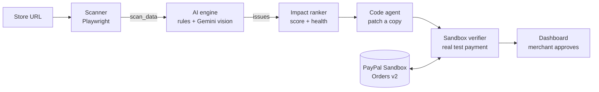

# 🧭 CheckoutPilot

**PayPal ships upgrades; merchants don't adopt them. CheckoutPilot finds what each store is missing, writes the upgrade, and proves it works before the merchant clicks approve.**

Built for the *Build What's Next with PayPal and AI* hackathon (2026).


---

## The problem

PayPal has built a faster, better-converting checkout: saved PayPal accounts, biometric login, Pay Later messaging and the newer JavaScript SDK v6. But each feature only helps when a merchant changes their own code, and many stores still run older integrations. PayPal has reported that branded checkout volume grew only 1–2% for four consecutive quarters, and that merchants needed far more integration help than expected. Shoppers get a clunkier checkout and stores lose sales.

## What CheckoutPilot does

Give it a store URL. It works in four steps:

| Step | What happens | How |
|---|---|---|
| **FIND** | Walks the store like a shopper (product → cart → checkout, desktop and mobile) and finds what is holding PayPal back | Playwright browser + rule checks + a vision AI model (Gemini) reading the screenshots |
| **RANK** | Orders the problems by business impact and gives the store a health score | Severity × category weights, with every assumption tied to a cited PayPal source |
| **FIX** | Writes the upgrade (SDK v5 → v6, PayPal on the cart page) as a pull request | Code agent working on a copy of the store, never the live code |
| **PROVE** | Completes a real PayPal **Sandbox** purchase on the store before and after the fix | Automated browser buyer + PayPal Orders API check |

The merchant sees the issues, the diff and the payment proof, and only then decides whether to approve. **Nothing is changed silently.**



## Results so far

Measured on our two demo stores (an outdated "before" store and an upgraded "after" store). Full tables: [docs/ai_results.md](docs/ai_results.md).

| What we measured | Result |
|---|---|
| Rule checks on 53 labelled scans (every combination of SDK version, PayPal placement and mobile layout) | **53/53 exactly right**, under 1 ms per scan |
| Gemini vision on 8 labelled screenshots | **8/8 exactly right, 0 false alarms**, about 3 s per image |
| Full scan of the legacy store (real browser → AI → ranking) | All **4 issues** found, health score **21/100**, in about 9 s |
| Full scan of the upgraded store | Only **1 issue** left (no PayPal on product page), health score **76/100** |
| Automated PayPal Sandbox purchase | **Passed on both stores**, orders `2P9857762V126102X` (SDK v5) and `6YR73749DK6395539` (SDK v6), both `COMPLETED` |

_The demo-store numbers show the pipeline works end to end; they are not a measurement across real merchants. Impact scores use PayPal's published figures as labelled assumptions and say "effect not measured for this store"._


## What CheckoutPilot checks

| Issue | Severity | Found by |
|---|---|---|
| `sdk_outdated`: store uses PayPal JS SDK v4/v5 instead of v6 | High | Rules (script URLs) |
| `no_paypal_on_cart`: no PayPal button on the cart page | High | Rules + vision |
| `no_paypal_on_product`: no PayPal on the product page | Medium | Rules |
| `button_below_fold_mobile`: PayPal hidden below the fold on phones | Medium | Rules (button position) + vision |
| `paypal_button_not_prominent`, `paypal_button_cluttered`, `checkout_layout_cramped_mobile` | Low–medium | Vision |

When the rules and the vision model agree on an issue, it is marked `rule+vision`.

## Project status

| Part | Status |
|---|---|
| AI engine (rules, Gemini vision, evaluation) | ✅ Done |
| Impact ranker + health score | ✅ Done |
| PayPal Sandbox client (Orders v2) | ✅ Done |
| Demo stores (legacy v5 + upgraded v6) | ✅ Done, real payments tested |
| Sandbox verifier (automated purchase) | ✅ Done |
| Scanner (Playwright) | ✅ Working, being merged |
| Backend API (`/api/scan`) | 🟡 Scans end to end; adding health score and evidence to the response |
| Code agent (FIX) | 🟡 In progress |
| Dashboard (Streamlit) | 🟡 In progress |

## Quick start

You need **Python 3.10+** and **Git**.

```bash
git clone https://github.com/shravanisy2006/CheckoutPilot.git
cd CheckoutPilot
python -m venv venv
venv\Scripts\activate            # Windows PowerShell: venv\Scripts\Activate.ps1   macOS/Linux: source venv/bin/activate
pip install -r requirements.txt
playwright install chromium
copy .env.example .env           # macOS/Linux: cp .env.example .env
```

Fill in `.env` (see [Environment variables](#environment-variables)), then try each part:

```bash
# Run the two demo stores
python -m demo_stores.serve legacy       # http://localhost:8101  (before)
python -m demo_stores.serve upgraded     # http://localhost:8102  (after)

# Check your PayPal Sandbox keys
python -m paypal_integration.try_paypal

# Prove checkout works: real Sandbox purchase on both stores (starts the stores for you)
python -m sandbox_verifier.verify both --headed

# Measure the AI
python -m ai_engine.capture_eval_shots
python -m ai_engine.evaluate --vision-cases outputs/eval_shots/eval_cases.json --markdown docs/ai_results.md

# Backend + dashboard
uvicorn backend.main:app --reload        # http://localhost:8000/docs
streamlit run frontend/app.py            # http://localhost:8501

# Tests
python -m pytest -q
```

## The demo stores

`demo_stores/` holds one small shop, **Inkwell & Co.**, in two versions:

| | `legacy_store` (port 8101) | `upgraded_store` (port 8102) |
|---|---|---|
| PayPal SDK | v5 (`paypal.com/sdk/js`) | v6 (`web-sdk/v6/core`) |
| PayPal on cart | No | Yes (express checkout) |
| PayPal on mobile | Below a long form | First screen |
| Price calculation | Server side | Server side |

Prices are always calculated on the server from item IDs; the browser never sends an amount.

## Safety

- **Sandbox only.** The PayPal client refuses any API URL that is not `sandbox`. The verifier only types the test buyer's login into `www.sandbox.paypal.com` and only tests stores on `localhost`.
- **No silent changes.** The code agent patches a copy and opens a pull request; the merchant decides.
- **Secrets stay local.** Keys live only in `.env`, which is git-ignored. The verifier never prints or saves the buyer password.
- **Honest numbers.** Impact estimates cite their source and say when an effect was not measured.

## Technology

| Layer | Technology |
|---|---|
| Browser automation | Playwright (Python, Chromium) |
| AI | Gemini (vision) via REST; Anthropic and OpenAI also supported (`AI_PROVIDER`) |
| Payments | PayPal REST APIs (Sandbox): OAuth, Orders v2; JavaScript SDK v5 and v6 |
| Backend | FastAPI + Uvicorn |
| Frontend | Streamlit |
| Tests | pytest (160+ tests) |

## Project structure

```
CheckoutPilot/
├── scanner/              # Playwright: walks product → cart → checkout, desktop + mobile
├── ai_engine/            # rule checks, Gemini vision, evaluation tools
├── impact_ranker/        # impact scores, health score, cited assumptions
├── code_agent/           # writes the upgrade as a pull request
├── paypal_integration/   # PayPal Sandbox client (token, create/get/capture order) + mock
├── sandbox_verifier/     # automated Sandbox purchase with proof
├── demo_stores/          # legacy_store (v5) and upgraded_store (v6) + serve.py launcher
├── backend/              # FastAPI: /api/scan, /api/health, /api/reports
├── frontend/             # Streamlit dashboard
├── tests/                # pytest
└── docs/                 # architecture.md, ai_results.md, images/
```

Modules talk only through plain dictionaries; each has a mock (`MOCK_PAYPAL`, `MOCK_VERIFIER`, …) so the backend and dashboard can be built without a browser or API keys. See [docs/architecture.md](docs/architecture.md).

## Environment variables

Copy `.env.example` to `.env` and fill in **your own** values. Never put real values in `.env.example`.

| Variable | What it is |
|---|---|
| `AI_PROVIDER`, `AI_MODEL`, `AI_FALLBACK_MODEL` | e.g. `gemini`, `gemini-3.8-flash`, `gemini-3.5-flash-lite` |
| `GOOGLE_API_KEY` (or `ANTHROPIC_API_KEY` / `OPENAI_API_KEY`) | Key for the chosen AI provider |
| `AI_VISION_ENABLED`, `AI_TIMEOUT_SECONDS` | Turn vision on/off; seconds to wait per AI call |
| `PAYPAL_CLIENT_ID`, `PAYPAL_CLIENT_SECRET` | developer.paypal.com → Apps & Credentials → **Sandbox** |
| `PAYPAL_SANDBOX_BUYER_EMAIL`, `PAYPAL_SANDBOX_BUYER_PASSWORD` | A **United States Personal** Sandbox account (Testing Tools → Sandbox Accounts) |
| `MOCK_PAYPAL`, `MOCK_VERIFIER` | `true` to use fake results without PayPal or a browser |
| `BACKEND_URL`, `CORS_ORIGINS` | Where the dashboard finds the backend |
| `GITHUB_TOKEN` | For the code agent to open pull requests |

**Sandbox tips we learned the hard way:**
- Pay with a **Personal** account, never the Business (seller) one, or PayPal says "You are logging in to the account of the seller".
- Use a **United States** Personal account. India-to-India Sandbox payments fail with "Things don't appear to be working".

## Contributing

`main` always holds working code, and nobody pushes to it directly.

```bash
git checkout main && git pull
git checkout -b feature/<module>-<short-description>
# ...work...
git add <your-module-folder> tests      # never "git add ."
git status && git diff --cached         # check: no .env, no keys, no screenshots
git commit -m "scanner: save screenshots for each checkout step"
git push -u origin feature/<module>-<short-description>
```

Then open a pull request into `main`. Before opening it: `pytest` passes, you only changed your own module (unless agreed), and no keys or `.env` are included.

## License

MIT — see [LICENSE](LICENSE).
