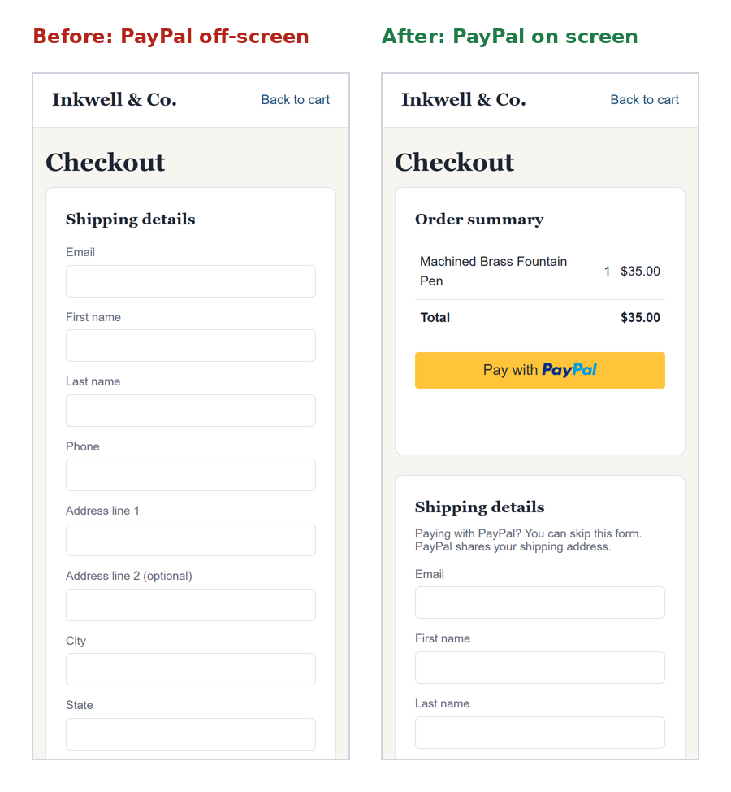
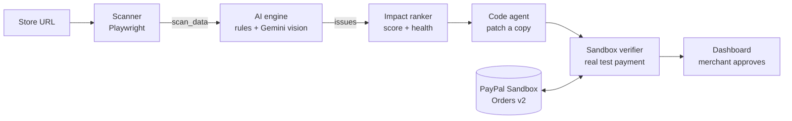
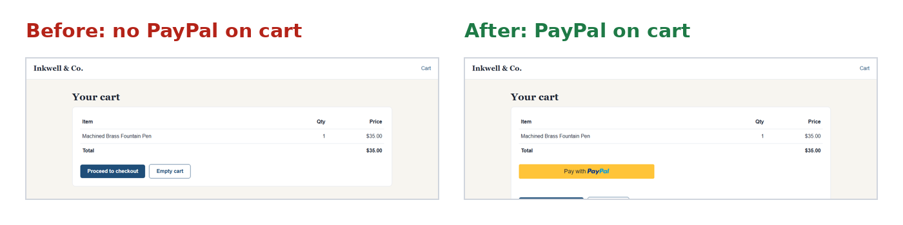
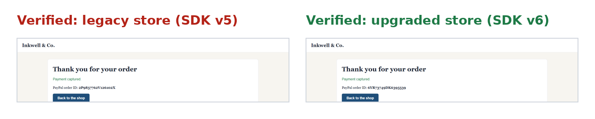

# 🧭 CheckoutPilot

**PayPal ships upgrades; merchants don't adopt them. CheckoutPilot finds what each store is missing, writes the upgrade, and proves it works before the merchant clicks approve.**

Built for the *Build What's Next with PayPal and AI* hackathon (2026).

### Try it

| | |
|---|---|
| **Live app** (dashboard + API + example stores) | <https://checkoutpilot.onrender.com> |
| **API docs** | <https://checkoutpilot.onrender.com/docs> |
| **Run it yourself** | [Quick start](#quick-start): `python run_demo.py --mock` needs no keys |

In the dashboard, **Demo** mode replays one real recorded run instantly; **Live** mode runs the real scanner,
code agent and PayPal Sandbox payments. The hosted backend is on a free plan: the first request can take
about a minute while it wakes up, and each Live step takes 1–3 minutes (seconds when run locally).



---

## The problem

PayPal has built a faster, better-converting checkout: saved PayPal accounts, biometric login, Pay Later messaging and the newer JavaScript SDK v6. But each feature only helps when a merchant changes their own code, and many stores still run older integrations. PayPal has reported that branded checkout volume grew only 1–2% for four consecutive quarters, and that merchants needed far more integration help than expected. Shoppers get a clunkier checkout and stores lose sales.

## What CheckoutPilot does

Give it a store URL. It works in four steps:

| Step | What happens | How |
|---|---|---|
| **FIND** | Walks the store like a shopper (product → cart → checkout, desktop and mobile) and finds what is holding PayPal back | Playwright browser + rule checks + a vision AI model (Gemini) reading the screenshots |
| **RANK** | Orders the problems by business impact and gives the store a health score | Severity × category weights, with every assumption tied to a cited PayPal source |
| **FIX** | Writes the upgrade (SDK v5 → v6, PayPal on the cart page) with a diff for every file | Code agent working on a copy of the store, never the live code |
| **PROVE** | Completes a real PayPal **Sandbox** purchase on the store before and after the fix | Automated browser buyer + PayPal Orders API check |
| **RE-MEASURE** | Scans the fixed copy again and shows what changed: health score, issues fixed, SDK version | Same scanner, run on the code agent's copy |

The merchant sees the issues, the diff and the payment proof, and only then decides whether to approve. **Nothing is changed silently.**



## Results so far

Measured on our two demo stores (an outdated "before" store and an upgraded "after" store). Full tables: [docs/ai_results.md](docs/ai_results.md).

| What we measured | Result |
|---|---|
| Rule checks on 53 labelled scans (every combination of SDK version, PayPal placement and mobile layout) | **53/53 exactly right**, under 1 ms per scan |
| Gemini vision on 8 labelled screenshots | **8/8 exactly right, 0 false alarms**, about 3 s per image |
| Full scan of the legacy store (real browser → AI → ranking) | All **4 issues** found, health score **21/100**, in about 9 s |
| Full scan of the upgraded store | Only **1 issue** left (no PayPal on product page), health score **76/100** |
| Re-measure after the code agent's fix (same scanner on the fixed copy) | Health **21 → 76 (+55)**, **3 of 4** issues fixed, now on SDK v6 |
| Automated PayPal Sandbox purchase | **Passed on both stores**, orders `2P9857762V126102X` (SDK v5) and `6YR73749DK6395539` (SDK v6), both `COMPLETED` |

_The demo-store numbers show the pipeline works end to end; they are not a measurement across real merchants. Impact scores use PayPal's published figures as labelled assumptions and say "effect not measured for this store"._





## What CheckoutPilot checks

| Issue | Severity | Found by |
|---|---|---|
| `sdk_outdated`: store uses PayPal JS SDK v4/v5 instead of v6 | High | Rules (script URLs) |
| `no_paypal_on_cart`: no PayPal button on the cart page | High | Rules + vision |
| `no_paypal_on_product`: no PayPal on the product page | Medium | Rules |
| `button_below_fold_mobile`: PayPal hidden below the fold on phones | Medium | Rules (button position) + vision |
| `paypal_button_not_prominent`, `paypal_button_cluttered`, `checkout_layout_cramped_mobile` | Low–medium | Vision |

When the rules and the vision model agree on an issue, it is marked `rule+vision`.

## Project status

| Part | Status |
|---|---|
| AI engine (rules, Gemini vision, evaluation) | ✅ Done |
| Impact ranker + health score | ✅ Done |
| PayPal Sandbox client (Orders v2) | ✅ Done |
| Demo stores (legacy v5 + upgraded v6) | ✅ Done, real payments tested |
| Sandbox verifier (automated purchase) | ✅ Done, passes on both stores (headless and visible) |
| Scanner (Playwright) | ✅ Done |
| Backend API | ✅ `/api/scan`, `/api/fix`, `/api/fix/{id}/rescan`, `/api/verify`, `/api/reports`, `/files`; long steps can run as background jobs (`/api/jobs/{id}`) |
| Code agent (FIX) | ✅ Patches a copy of the store (v5 → v6, cart button, mobile layout) and self-tests it in a browser; AI plan + template upgrade with a key, template only without one (`generated_by` says which). Opening real pull requests: 🟡 next |
| Owner summary | ✅ Gemini explains the audit in plain words, with guardrails (no invented numbers) and a template fallback |
| Dashboard (React) | ✅ Guided steps with pop-up help, example stores, AG Grid findings table + CSV export, before/after re-measure, "what could this be worth" calculator, PDF report; Demo and Live mode |
| Hosting | ✅ Render (backend, Docker) + Vercel (dashboard); also runs on Azure App Service |
| One-command launcher (`run_demo.py`) | ✅ Done, with `--mock` mode for running without keys |

## Quick start

**Platform:** a web app that runs locally on **Windows, macOS or Linux**.
**You need:** Python 3.10+, Node.js 20+ (for the dashboard) and Git. The PayPal **Sandbox** and a Gemini API key are optional: `--mock` runs everything without keys.

```bash
git clone https://github.com/shravanisy2006/CheckoutPilot.git
cd CheckoutPilot
python -m venv venv
venv\Scripts\activate            # PowerShell: venv\Scripts\Activate.ps1   macOS/Linux: source venv/bin/activate
pip install -r requirements.txt
playwright install chromium

python run_demo.py --mock         # no keys needed: simulated PayPal + verifier, AI rule checks
# or
python run_demo.py                # real mode: fill in .env first (PayPal Sandbox + Gemini keys)
```

`run_demo.py` creates `.env` from `.env.example` if it is missing, checks your setup, and starts everything:

| What | Address |
|---|---|
| **Dashboard** (open this) | http://localhost:5173 |
| Backend API docs | http://localhost:8000/docs |
| Legacy demo store (SDK v5, "before") | http://localhost:8101 |
| Upgraded demo store (SDK v6, "after") | http://localhost:8102 |

In the dashboard: **Audit → enter `http://localhost:8101` → Start scan**, then Recommendations → Fix → Proof.
The dashboard's **Demo** switch replays recorded real results with no backend at all; **Live** calls the backend.
Press **Ctrl+C** to stop everything. Logs are in `outputs/logs/`.

Other useful commands:

```bash
python run_demo.py --check                          # only check the setup
python run_demo.py --smoke-test                     # start, scan the legacy store once, stop
python -m paypal_integration.try_paypal             # check your PayPal Sandbox keys
python -m sandbox_verifier.verify both --headed     # real Sandbox purchase on both stores, watch it pay
python -m scripts.real_store_trial --file scripts/stores.txt --no-vision   # try public stores (FIND only)
python -m scripts.record_demo        # with `python run_demo.py` running (real mode): re-record Demo Mode from one live run
python -m ai_engine.capture_eval_shots              # AI evaluation screenshots, then:
python -m ai_engine.evaluate --vision-cases outputs/eval_shots/eval_cases.json --markdown docs/ai_results.md
python -m pytest -q                                 # Python tests
cd frontend-react && npm test                       # dashboard tests
```

**What needs which keys:**

| Feature | Without keys (`--mock`) | With keys |
|---|---|---|
| Scan a store, find and rank issues | ✅ (rule checks) | ✅ + Gemini vision on screenshots |
| Real PayPal Sandbox payment (PROVE) | simulated, clearly labelled | ✅ real Sandbox order, checked with the Orders API |
| Dashboard Demo mode | ✅ | ✅ |

### Hosted version (free: Vercel + Render)

- **Dashboard on Vercel** (static build, Demo mode always on): [`frontend-react/vercel.json`](frontend-react/vercel.json)
- **Backend on Render** (free web service, Docker): [`render.yaml`](render.yaml), with `FREE_TIER=true`
  so the scanner, verifier and example stores fit the free plan, and a per-visitor rate limit.

Step by step: [`docs/deploy_vercel_render.md`](docs/deploy_vercel_render.md). The same Docker image
also runs as one service on Azure App Service: [`docs/deploy_azure.md`](docs/deploy_azure.md).

## The demo stores

`demo_stores/` holds one small shop, **Inkwell & Co.**, in two versions:

| | `legacy_store` (port 8101) | `upgraded_store` (port 8102) |
|---|---|---|
| PayPal SDK | v5 (`paypal.com/sdk/js`) | v6 (`web-sdk/v6/core`) |
| PayPal on cart | No | Yes (express checkout) |
| PayPal on mobile | Below a long form | First screen |
| Price calculation | Server side | Server side |

Prices are always calculated on the server from item IDs; the browser never sends an amount.

## Safety

- **Sandbox only.** The PayPal client refuses any API URL that is not `sandbox`. The verifier only types the test buyer's login into `www.sandbox.paypal.com` and only tests stores on `localhost`.
- **No silent changes.** The code agent patches a copy and shows every diff; nothing goes live until the merchant approves.
- **Secrets stay local.** Keys live only in `.env`, which is git-ignored. The verifier never prints or saves the buyer password.
- **Honest numbers.** Impact estimates cite their source and say when an effect was not measured.

## Technology

| Layer | Technology |
|---|---|
| Browser automation | Playwright (Python, Chromium) |
| AI | Gemini (vision) via REST; Anthropic and OpenAI also supported (`AI_PROVIDER`) |
| Payments | PayPal REST APIs (Sandbox): OAuth, Orders v2; JavaScript SDK v5 and v6 |
| Backend | FastAPI + Uvicorn |
| Frontend | React dashboard (`frontend-react/`, Vite + TanStack); legacy Streamlit page in `frontend/` |
| Tables in the dashboard | **AG Grid** Community: sortable, filterable "All findings" grid on the Audit page |
| API docs and SDKs | **APIMatic**: developer portal and client SDKs generated from [`docs/openapi.json`](docs/openapi.json) (see [`docs/apimatic.md`](docs/apimatic.md)) |
| Hosting | Dashboard on **Vercel**; backend as a Docker web service on **Render** ([`render.yaml`](render.yaml)); also runs on Azure App Service |
| Tests | pytest (330+ tests) and Vitest (40 dashboard tests) |

## Sponsor tools

| Tool | How CheckoutPilot uses it |
|---|---|
| **AG Grid** | The "All findings" table on the Audit page: sortable, filterable columns and one-click CSV export |
| **Render** | Hosts the backend (API, scanner, Sandbox verifier and example stores) as a Docker web service ([`render.yaml`](render.yaml)) |
| **APIMatic** | API description ready for an APIMatic developer portal and SDKs ([`docs/openapi.json`](docs/openapi.json), [`docs/apimatic.md`](docs/apimatic.md)) |

## Project structure

```
CheckoutPilot/
├── scanner/              # Playwright: walks product → cart → checkout, desktop + mobile
├── ai_engine/            # rule checks, Gemini vision, owner summary, evaluation tools
├── impact_ranker/        # impact scores, health score, cited assumptions
├── code_agent/           # writes the upgrade on a copy of the store + browser self-test
├── paypal_integration/   # PayPal Sandbox client (token, create/get/capture order) + mock
├── sandbox_verifier/     # automated Sandbox purchase with proof
├── demo_stores/          # Inkwell & Co.: legacy_store (v5) and upgraded_store (v6) + serve.py launcher
├── backend/              # FastAPI: scan, fix, re-scan, verify, reports, jobs; hosting settings
├── frontend-react/       # React dashboard (Vite + TanStack, AG Grid); vercel.json for hosting
├── frontend/             # older Streamlit page
├── scripts/              # record_demo (re-record Demo mode), real_store_trial, export_openapi
├── tests/                # pytest
├── docs/                 # architecture, API contract, AI results, deploy guides, images
├── Dockerfile            # one image: dashboard + API + example stores (Render / Azure)
├── render.yaml           # Render blueprint for the backend
└── run_demo.py           # one command to start everything locally
```

Modules talk only through plain dictionaries; each has a mock (`MOCK_PAYPAL`, `MOCK_VERIFIER`, …) so the backend and dashboard can be built without a browser or API keys. See [docs/architecture.md](docs/architecture.md).

## Environment variables

Copy `.env.example` to `.env` and fill in **your own** values. Never put real values in `.env.example`.

| Variable | What it is |
|---|---|
| `AI_PROVIDER`, `AI_MODEL`, `AI_FALLBACK_MODEL` | e.g. `gemini`, `gemini-3.8-flash`, `gemini-3.5-flash-lite` |
| `GOOGLE_API_KEY` (or `ANTHROPIC_API_KEY` / `OPENAI_API_KEY`) | Key for the chosen AI provider |
| `AI_VISION_ENABLED`, `AI_TIMEOUT_SECONDS` | Turn vision on/off; seconds to wait per AI call |
| `PAYPAL_CLIENT_ID`, `PAYPAL_CLIENT_SECRET` | developer.paypal.com → Apps & Credentials → **Sandbox** |
| `PAYPAL_SANDBOX_BUYER_EMAIL`, `PAYPAL_SANDBOX_BUYER_PASSWORD` | A **United States Personal** Sandbox account (Testing Tools → Sandbox Accounts) |
| `MOCK_PAYPAL`, `MOCK_VERIFIER` | `true` to use fake results without PayPal or a browser |
| `BACKEND_URL`, `CORS_ORIGINS` | Where the dashboard finds the backend |
| `GITHUB_TOKEN` | For the code agent to open pull requests |
| `ASYNC_JOBS`, `FREE_TIER`, `RATE_LIMIT_PER_HOUR`, `CORS_ORIGIN_REGEX`, … | Hosting only (set in `render.yaml` / the Dockerfile); leave unset locally. See [`docs/deploy_vercel_render.md`](docs/deploy_vercel_render.md) |

**Sandbox tips we learned the hard way:**
- Pay with a **Personal** account, never the Business (seller) one, or PayPal says "You are logging in to the account of the seller".
- Use a **United States** Personal account. India-to-India Sandbox payments fail with "Things don't appear to be working".

## Contributing

`main` always holds working code, and nobody pushes to it directly.

```bash
git checkout main && git pull
git checkout -b feature/<module>-<short-description>
# ...work...
git add <your-module-folder> tests      # never "git add ."
git status && git diff --cached         # check: no .env, no keys, no screenshots
git commit -m "scanner: save screenshots for each checkout step"
git push -u origin feature/<module>-<short-description>
```

Then open a pull request into `main`. Before opening it: `pytest` passes, you only changed your own module (unless agreed), and no keys or `.env` are included.

## Team

| Member | Part |
|---|---|
| Shravani Yalagatti ([@shravanisy2006](https://github.com/shravanisy2006)) | AI engine + impact ranker, PayPal integration, demo stores, Sandbox verifier, deployment |
| Roshan ([@RoshanS-Dev](https://github.com/RoshanS-Dev)) | Scanner |
| Purvika ([@purvikapatil20-alt](https://github.com/purvikapatil20-alt)) | Backend API |
| Aarya ([@aarya3106](https://github.com/aarya3106)) | React dashboard |
| Harsh | Code agent |

## License

MIT — see [LICENSE](LICENSE).
